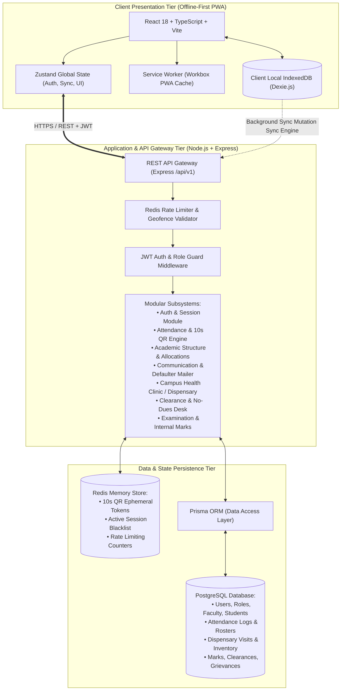
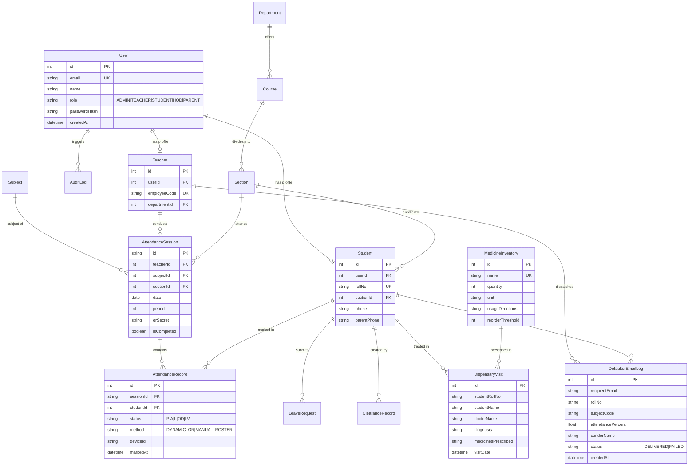
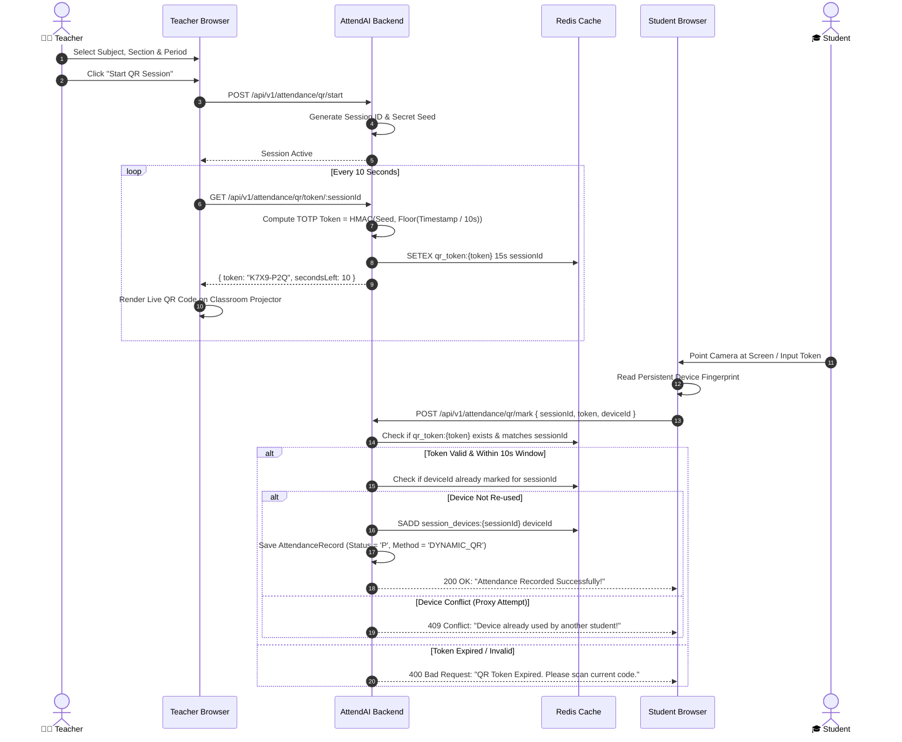
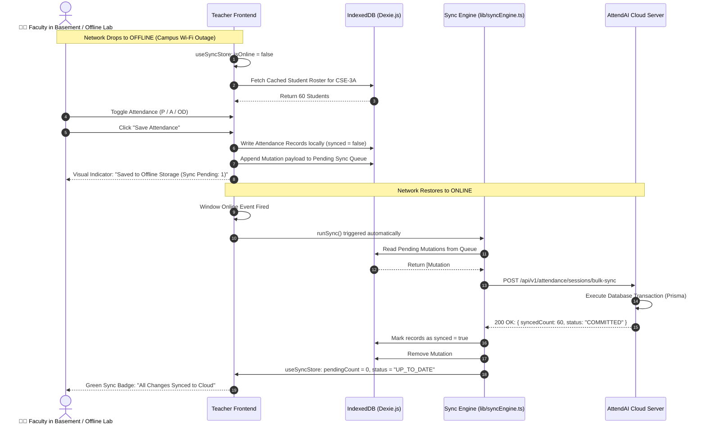
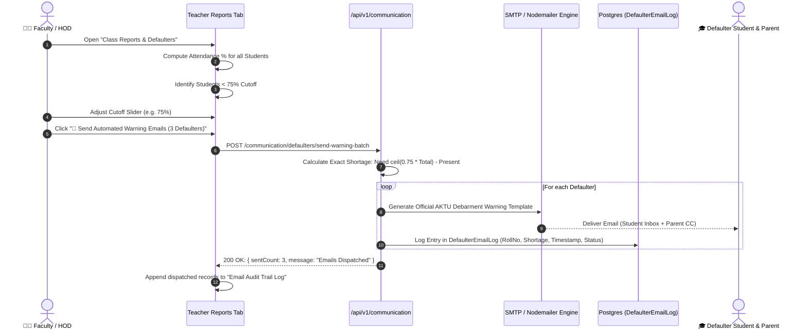
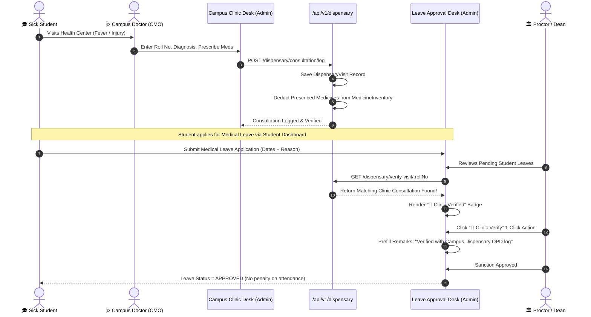
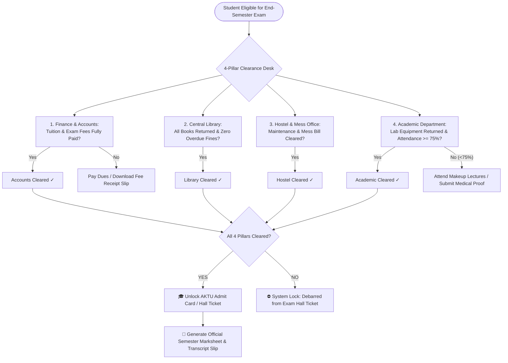

# AttendAI: System Architecture, System Design & Workflow Specification

---

## 1. Executive Summary & Core Purpose

**AttendAI** is an offline-first, anti-proxy, web-based College ERP and Intelligent Attendance Management System tailored for engineering colleges (specifically aligned with the **Dr. A.P.J. Abdul Kalam Technical University (AKTU)** framework). 

It solves the dual challenges of conventional ERPs:
1. **Attendance Fraud & Proxy**: Eliminated through **10-second rotating encrypted QR codes**, persistent device fingerprinting, and dynamic token validation.
2. **Network Fragility in Campuses**: Solved via an **Offline-First Progressive Web App (PWA)** architecture backed by **IndexedDB (Dexie.js)** and background mutation replay queues.
3. **Fragmented Campus Operations**: Unified modules for **Attendance, Internal Marks, Automated Defaulter Emailing, Campus Dispensary OPD, No-Dues Clearances, Placement Drives, and Grievance Redressal**.

---

## 2. High-Level System Architecture

AttendAI operates on a modern, decoupled **3-Tier Distributed Architecture** with resilient offline caching:

---

## 3. Layered Architectural Decomposition

### 3.1. Client Presentation Tier
* **Technology Stack**: React 18/19, TypeScript, Vite, Vanilla CSS design tokens (custom glassmorphic theme with warm institutional accents), Lucide-styled iconography.
* **State Management**: Zustand stores (`useAuthStore`, `useSyncStore`).
* **Local Storage & Persistence**:
  * **Dexie.js (IndexedDB)**: Stores offline rosters, section bootstrap caches, student attendance records, pending mutation replay queue.
  * **LocalStorage**: Scratchpad memo text, user preference flags, persistent device fingerprint ID.
* **PWA Service Worker**: Workbox-powered offline caching of static assets (JS, CSS, SVGs, 3D Hero image).

### 3.2. Application & API Tier
* **Technology Stack**: Node.js, Express, TypeScript, Zod/Joi schema validation.
* **Security & Auth**:
  * Dual-token JWT (Access Token + Refresh Token).
  * Role-Based Access Control (RBAC): `ADMIN`, `TEACHER`, `HOD`, `STUDENT`, `PARENT`.
  * Rate-limiting and CORS isolation.
* **Core Engine Controllers**:
  1. `auth.routes.ts`: Password auth, 1-Click demo accounts, Google OAuth token exchange.
  2. `attendance.routes.ts`: Session lifecycle, manual rosters, QR attendance confirmation.
  3. `qr.routes.ts`: Rotating QR token generator with Redis validation.
  4. `communication/routes.ts`: Defaulter batch warning email dispatcher with delivery auditing.
  5. `dispensary/routes.ts`: Campus clinic OPD visits, pharmacy stock threshold ledger, emergency hospital referrals.
  6. `clearance.routes.ts`: 4-pillar no-dues workflow and admit card unlocking.
  7. `marks.routes.ts`: AKTU Sessional marks entry, grade calculation, and transcript formatting.

### 3.3. Data & Cache Tier
* **PostgreSQL Relational DB**: ACID-compliant persistent store for all institutional records.
* **Prisma ORM**: Type-safe query engine and automated migration management.
* **Redis**: Microsecond in-memory key-value store for:
  * Ephemeral rotating QR session tokens (TTL = 10 seconds).
  * Device fingerprint claim locks (1 student device per session).

---

## 4. Database Schema & Data Modeling

---

## 5. Core Operational Workflows

### 5.1. Anti-Proxy 10-Second Rotating QR Attendance Workflow

---

### 5.2. Offline-First Attendance Marking & Sync Workflow

---

### 5.3. Defaulter Shortage Calculation & Warning Email Workflow

---

### 5.4. Campus Dispensary OPD & Medical Leave Cross-Verification Workflow

---

### 5.5. 4-Pillar Digital No-Dues & Examination Hall Ticket Workflow

---

## 6. Role-Based Access Control (RBAC) Matrix

| Feature / Module | Student | Teacher | HOD | Admin / Dean | Parent |
| :--- | :---: | :---: | :---: | :---: | :---: |
| **Mark Attendance (10s Live QR)** | ❌ | ✅ | ✅ | ❌ | ❌ |
| **Scan QR / Confirm Attendance** | ✅ | ❌ | ❌ | ❌ | ❌ |
| **Manual Roster Grading & Overrides**| ❌ | ✅ | ✅ | ✅ | ❌ |
| **Bunk / Attendance Shortage Forecast**| ✅ | ✅ (Class) | ✅ (Dept) | ✅ (College) | ✅ |
| **Download AKTU Semester Marksheet** | ✅ | ❌ | ✅ | ✅ | ✅ |
| **Download Official Paid Fee Receipt**| ✅ | ❌ | ❌ | ✅ | ✅ |
| **Defaulter Email Batch Dispatch** | ❌ | ✅ | ✅ | ✅ | ❌ |
| **Campus Clinic / Dispensary Desk** | ❌ (View) | ❌ | ❌ | ✅ | ❌ |
| **Medical / Duty Leave Sanctions** | Apply | Endorse | Sanction | Sanction | ❌ |
| **4-Pillar No-Dues Clearance Desk**| View Slip | ❌ | Department | Super Admin | ❌ |
| **Placement Drives Registration** | ✅ | ❌ | ❌ | Manage | ❌ |
| **Anonymous Grievance Filing** | ✅ | ✅ | View Dept | Resolve All | ❌ |
| **Floating Academic Utility Dock** | ✅ | ✅ | ✅ | ✅ | ✅ |

---

## 7. Security, Integrity & Performance Specifications

1. **Proxy Prevention (Zero-Trust Model)**:
   - Dynamic 10-second token rotation ensures photos or screenshots transmitted across WhatsApp/Telegram expire before a remote student can type or scan them.
   - Device fingerprint hash (`localStorage` + browser characteristics) prevents a single student from logging in for multiple peers on the same phone.
2. **Resilience to Network Failures**:
   - IndexedDB handles full offline attendance marking when teacher enters shielded lecture halls or basements with zero cellular signal.
   - PWA Service Worker precaches the application shell for instant 0ms reload.
3. **Auditability & Traceability**:
   - Every single status change, leave sanction, marks submission, and defaulter email is immutably timestamped in the PostgreSQL database with the author's user ID and role.
4. **Data Privacy**:
   - Medical consultation records and grievance disclosures adhere to institutional privacy guidelines, accessible exclusively to authorized Chief Medical Officers and administrative proctors.
