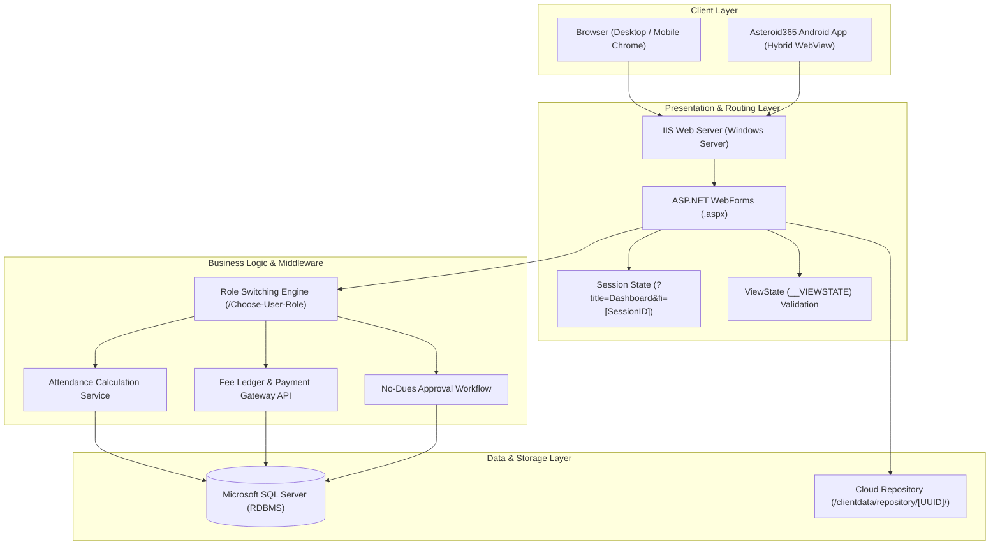

# Comprehensive System & Architectural Analysis Report: KIT ERP (Asteroid365)

**Target System:** Kanpur Institute of Technology ERP Portal (`https://erp.kit.ac.in/`)  
**Engine & Vendor:** Asteroid365 — Intelligent Institute Automation System (IERP) by Vriendelike Technologies  
**Portal Version:** Version 4.2, Build 260810  
**Inspection Date:** October 2026  
**Mode:** Exhaustive Live Inspection (Read-Only)

---

## Executive Summary

This report provides an exhaustive, end-to-end breakdown of the **Kanpur Institute of Technology (KIT) ERP System**. Every entry point, multi-campus routing mechanism, authentication gateway, sidebar module, dashboard widget, evaluation framework, and underlying software architecture was inspected directly from the live production portal.

---

## 1. Multi-Campus Gateway & Institutional Architecture

The root URL (`https://erp.kit.ac.in/`) serves as a **Multi-Tenant Gateway** hosting three distinct academic institutions operating under the same educational group:

| Institution Name | Affiliation & Code | Internal Institute GUID | Mobile App Join Code |
|---|---|---|---|
| **Kanpur Institute of Technology** | AKTU Code: 165 | `99827784-c630-4803-8970-d32a75007b1e` | `KIT165` |
| **Kanpur Institute of Technology And Pharmacy** | AKTU Code: 550 & BTE Code: 3380 | `f8d45021-625e-413c-ada6-38119546888b` | `KIT550` |
| **Kanpur Institute of Higher Education** | CSJMU Code: KN192 | `d235c3b2-968a-4300-823b-c67d61432b31` | `KN192` |

### Public Auxiliary Services on Gateway:
1. **Admission Inquiry Form Panel:** Modal overlay containing an iframe for prospective student lead generation.
2. **Circulars/Public Notices Modal:** Live broadcast board showing university and institute orders before login.
3. **Android App Gateway:** Direct redirection to Google Play Store package `com.asteroid365.asteroid365`.

---

## 2. Authentication & Multi-Role Gateway (`Start.aspx`)

Upon selecting an institution, the user is routed to `Start.aspx?institute=[GUID]` which presents **6 distinct login portals**:

```
[ Institute Gateway: Start.aspx ]
  ├── 1. Students Login (Role Code: 'S')
  ├── 2. Employees Login (Role Code: 'F')
  ├── 3. Career Portal (Role Code: 'C')
  ├── 4. Super Login / Power User (Role Code: 'SL')
  ├── 5. Online Exam (Role Code: 'OE')
  └── 6. Exam Results (Role Code: 'ER')
```

### Role-Switching Engine:
The application includes a `/Choose-User-Role` middleware. When a user account possesses multiple privileges (e.g., student who is also a lab assistant, or faculty who is an admin), the system prompts role selection before granting session access.

---

## 3. Active Session & Student Profile Metadata

* **Active Student Name:** Aman Kumar
* **Degree & Specialization:** Bachelor of Technology in Computer Science & Engineering (B.Tech. CSE)
* **Academic Year & Semester:** 4th Year, 7th Semester (Section A)
* **College Registration Number (CRN):** `233206`
* **University Roll Number (URN / AKTU Roll No):** `2301650100024`
* **Active Session:** Academic Year 2026-27
* **Session URL Pattern:** `https://erp.kit.ac.in/Dashboard?title=Dashboard&fi=11265171`

---

## 4. Global Header & Control Bar Features

| Control | Element ID / Selector | Functionality & Workflow | Real-World Purpose |
|---|---|---|---|
| **Hamburger Menu Toggle** | `id="showLeftMenu"` | Expands the collapsible full left sidebar containing all academic and administrative trees. | Global navigation across all sub-modules. |
| **Global Page Search** | `id="txtSearchPage"` | Auto-complete live search bar that queries page names across the system. | Quick-jump navigation without traversing menus. |
| **Online-Classes** | Top Navbar link | Redirects to scheduled live lecture links (Google Meet / Microsoft Teams / LMS). | Hybrid / remote learning lectures access. |
| **Placement Portal** | Top Navbar link | Links to Training & Placement (T&P) Cell database. | Campus placement drives, eligible company job postings, resume uploads. |
| **Grievance Redressal** | Top Navbar & Profile | Opens the Student Grievance Submission interface. Categorized into Academic, Anti-Ragging, Fee, Facilities, and Administrative. | Formal student complaint tracking with SLA escalation. |
| **Academic Session Switcher** | Header dropdown | Dropdown populated with past sessions (2025-26, 2024-25, etc.). Switching reloads the entire dashboard context. | Viewing historical semester records, back papers, and past marksheets. |
| **Profile Menu** | `id="divProfileMenu"` | Contains: *My Profile*, *Settings*, *Submit Grievance*, *Feedback*, and *Log Out (`Ctrl + L`)*. | Personal profile management and secure session destruction. |

---

## 5. Exhaustive Sidebar Navigation Hierarchy

When opening the left sidebar (`#leftParentMenu`), the system exposes **5 primary categories** and **13 specialized sub-modules**:

### Category 1: Students (`leftParentMenu_1_3`)
* **1.1 Download Question Bank / Notes:**
  * *Data & Fields:* Subject dropdown (AI, Cloud Computing, Project Management, Quantitative Aptitude, Verbal Ability), Unit selector (Unit 1 to Unit 5), File Type (Lecture Notes, Question Bank, University Solved Papers).
  * *Workflow:* Student chooses subject and unit -> Server fetches uploaded PDFs -> Direct download.
  * *Purpose:* Academic study material distribution.
* **1.2 My Exam Result (Online):**
  * *Data & Fields:* Exam Type (Online Quiz, Mid-Term Pre-University Exam, Carry-Over Exam), Marks Obtained, Max Marks, Percentile, Rank in Class.
  * *Purpose:* Internal evaluation performance cards.
* **1.3 My Attendance (Students):**
  * *Data & Fields:* Cumulative percentage, Subject-wise breakdown, Total Lectures Held, Lectures Attended, Lectures Missed, Shortfall Count.
  * *Purpose:* Official semester attendance audit against the 75% university norm.
* **1.4 My Daily Attendance (Students):**
  * *Data & Fields:* Calendar date picker, Period 1 through Period 7 slots, Subject name, Status flags (`P` for Present, `A` for Absent, `L` for Approved Leave, `OD` for On-Duty).
  * *Purpose:* Daily slot-by-slot verification of presence.
* **1.5 My No Dues Form:**
  * *Data & Fields:* Multi-department clearance summary (Academic, Accounts, Library, DSW), printable PDF certificate with official stamp placeholders.
  * *Purpose:* Issuance of clearance certificate required for university admit card release.
* **1.6 Exam Registration:**
  * *Data & Fields:* Regular Semester Subject List, Carry-Over (Back Paper) Subjects, University Examination Fee status, Student Declaration checkbox.
  * *Purpose:* Official AKTU semester exam registration submission.

### Category 2: Online Registration (`leftParentMenu_1_142`)
* **2.1 Online Registration:**
  * *Data & Fields:* Student master verification, permanent & correspondence address, parent contact info, elective subject selections, anti-ragging undertaking.
  * *Purpose:* Mandatory beginning-of-semester re-registration.
* **2.2 Online Transport Service Registration:**
  * *Data & Fields:* Route Number, Bus Route Name (e.g. Bithoor Road, Kalyanpur, Rawatpur), Halt Point Code, Pickup Time, Semester Transport Fee addition.
  * *Purpose:* College bus allocation and digital transport pass generation.
* **2.3 Online Hostel Registration:**
  * *Data & Fields:* Hostel Block, Room Occupancy (Single / Double / Triple), AC / Non-AC selection, Mess Diet preference, Hostel Fee calculation.
  * *Purpose:* On-campus residential room allotment.

### Category 3: E-Learning (`leftParentMenu_1_604`)
* **3.1 Online Courses:**
  * *Data & Fields:* Self-paced learning modules, uploaded video recordings, reading PPTs, weekly assignment submissions.
  * *Purpose:* Digital blended learning and supplemental course content.

### Category 4: Utilities (`leftParentMenu_1_71`)
* **4.1 View Notice / Circular:**
  * *Data & Fields:* Notice Title, Issuing Authority (Director Office, Registrar, HOD, DSW), Issue Date, Expiration Date, Document Attachment URL (`/clientdata/repository/[UUID]/[filename].pdf`).
  * *Purpose:* Central institute circulars archive and official notifications.

### Category 5: Library (`leftParentMenu_1_690`)
* **5.1 View My Library Fine:**
  * *Data & Fields:* Book Accession Number, Book Title, Issue Date, Due Return Date, Actual Return Date, Overdue Days, Fine Rate (₹ per day), Net Outstanding Fine.
  * *Purpose:* Central Library fine audit and clearance verification.

---

## 6. Comprehensive Main Dashboard Widgets Analysis

Scrolling through the main dashboard page (~4735px vertical length) reveals the following active widgets:

### 1. Auto-Popup Circulars & Notices Window
* Automatically renders in front of the dashboard upon successful login.
* Displays urgent administrative bulletins:
  * AKTU Odd Semester Examination Fee Circular (AY 2026-27).
  * UP State Post-Matric Scholarship / Samaj Kalyan portal deadlines.
  * Annual Freshers' & Cultural Extravaganza (*Udbhav-2026*).
  * NSS / Red Cross Blood Donation Drive.
  * Mandatory ERP data verification for unregistered scholars.

### 2. Fee Management & Online Payment Ledger
* **Current Financial Standing:**
  * *Previous Year Outstanding Fee:* ₹0.00
  * *Current Year Fee Payable (Session 2026-27):* ₹52,500.00
  * *Net Balance Due:* ₹0.00 (Fully cleared for current installment)
* **Interactive Actions:**
  * `PAY FEE` button linking to integrated third-party payment gateway (Cards, Net Banking, UPI).
  * `Payment History` button generating digitally signed fee receipts and payment challan PDFs.

### 3. Cumulative Attendance Tracker
* **Visual Metric Representation:** High-contrast color-coded Pie Chart.
  * **Total Delivered Lectures:** `153`
  * **Attended Lectures:** `46`
  * **Absent Lectures:** `107`
  * **Current Aggregate Percentage:** **`30%`**
* **Regulatory Compliance Impact:**
  * Falls substantially below the **75% minimum attendance rule** mandated by AKTU Ordinance and institute policies.
  * Automatically flags the student account in the Defaulter Registry, preventing admit card issuance unless medical/OD adjustments are approved.

### 4. Continuous Internal Evaluation (Student Performance Record)
Covers all enrolled semester subjects across theoretical and practical evaluation parameters:
* **Subjects Evaluated:**
  1. Artificial Intelligence
  2. Cloud Computing
  3. Logical Reasoning
  4. Project Management
  5. Quantitative Aptitude
  6. Verbal Ability
* **Continuous Assessment Columns:**
  * *Assignment I & II:* Homework and analytical problem sets (Marks Obtained vs Max Marks).
  * *Sessional I Exam:* Mid-semester written test performance.
  * *Communication Assessment:* Soft skills, viva-voce, and seminar presentations.
  * *Verification Status:* Digital verification badge (`APPROVED` / `NOT APPROVED`) signed by the respective subject teacher.

### 5. Weekly Academic Timetable Matrix
* **Time Windows:** 7 continuous period slots from 09:10 AM to 04:55 PM.
* **Schedule Span:** Tuesday through Friday.
* **Slot Data Displayed:**
  * Course / Subject Title
  * Lecture Type (Classroom Lecture / Practical Computer Lab)
  * Allocated Room / Lab Number
  * Faculty Instructor Name

### 6. Enrolled Subjects & Syllabus Coverage Tracking
* Lists all 7th semester enrolled papers.
* Features a **Syllabus Coverage Progress Bar (%)** updated by faculty weekly to inform students of the exact academic pace before university exams.

### 7. Multi-Department No-Dues Clearance Matrix
A real-time 4-point administrative clearance grid essential for semester exam hall tickets and migration:
1. **Academic Cell:** Verifies sessional exam appearance and attendance threshold.
2. **Accounts Office:** Verifies tuition, exam, and development fee clearance.
3. **Central Library:** Verifies return of issued books and clearance of overdue fines.
4. **Student Welfare Cell (DSW):** Verifies hostel dues, disciplinary record, and club properties.
* *Indicators:* Dynamic color-coded **Updated** / **Not Updated** badges.

### 8. Institutional Contacts & Classmates Directory
* Details of the designated Class Coordinator / Faculty Mentor with email and cabin number.
* Student roster showing peer admission numbers, enrollment codes, and official institutional `@kit.ac.in` email handles.

---

## 7. Deep Technical Architecture & Stack Analysis



### Technical Stack Details:
1. **Web Application Framework:**
   - Microsoft **ASP.NET (.aspx)** with C# backend running on Microsoft IIS (Internet Information Services).
   - Server-Side Rendering (SSR) model utilizing the classic ASP.NET Page Life Cycle, ViewState serialization, and Event Validation.
2. **Client-Side Frameworks & Assets:**
   - Bundled JavaScript packages (`/bundles/js/Start`, `/bundles/js/Initials`).
   - jQuery 1.10.2 core library for DOM manipulation and AJAX calls.
   - ASP.NET AJAX `UpdatePanel` controls for partial asynchronous postbacks.
   - Anti-right-click handler (`oncontextmenu="return false;"`) on page body.
3. **Session Management & Routing Security:**
   - State tracked through a combination of HTTP cookies and mandatory query string parameters (`?title=Dashboard&fi=11265171`).
   - Deep-linking protection redirecting unauthenticated hits back to `Start.aspx`.
4. **Repository & Media Storage Architecture:**
   - Centralized, multi-tenant file repository organized under `/clientdata/repository/[Institutional_or_File_GUID]/[filename.pdf]`.
5. **Database Model (Inferred Relational Schema):**
   - Normalized MS SQL Server schema featuring foreign-key constraints linking:
     - `Institutes` (KIT, Pharmacy, Higher Education)
     - `Students` (CRN, AKTU Roll No, Course, Batch, Section)
     - `Faculty_Allocations` (Teacher to Subject-Section mapping)
     - `Lecture_Attendance` (Slot-based attendance entries)
     - `Sessional_Grades` (Continuous internal assessment records)
     - `Fee_Ledgers` (Invoices, transactions, balance breakdown)
     - `Department_Clearances` (No-dues sign-off flags)

---

## 8. Strategic Feature Comparison: KIT ERP vs AttendAI

| Dimension | Legacy KIT ERP (Asteroid365) | Modern AttendAI Platform |
|---|---|---|
| **Attendance Roll-Call** | Teacher manually enters marks lecture-by-lecture or passes paper register | **10-Second Rotating QR Code**: 60 students mark themselves in <60 seconds with zero proxy. |
| **Offline Resilience** | **Fails completely** without active internet (Server PostBack required). | **100% Offline-First PWA** powered by local IndexedDB (Dexie.js) and background sync. |
| **Defaulter Analytics** | Static 30% pie chart; no actionable forecast. | **Smart Defaulter Predictor**: Calculates exact number of consecutive classes needed to recover to 75%. |
| **System Performance** | Heavy ViewState payloads (>100KB per request), slow page reloads. | **Ultra-Fast Vite + React 19 SPA**: Instant transitions, sub-millisecond client cache. |
| **Audit & Security** | Basic server logs. | **Immutable Audit Trail**: Append-only log with HMAC-SHA256 tokens and user IP stamps. |

---

*Report saved directly in project root folder.*
