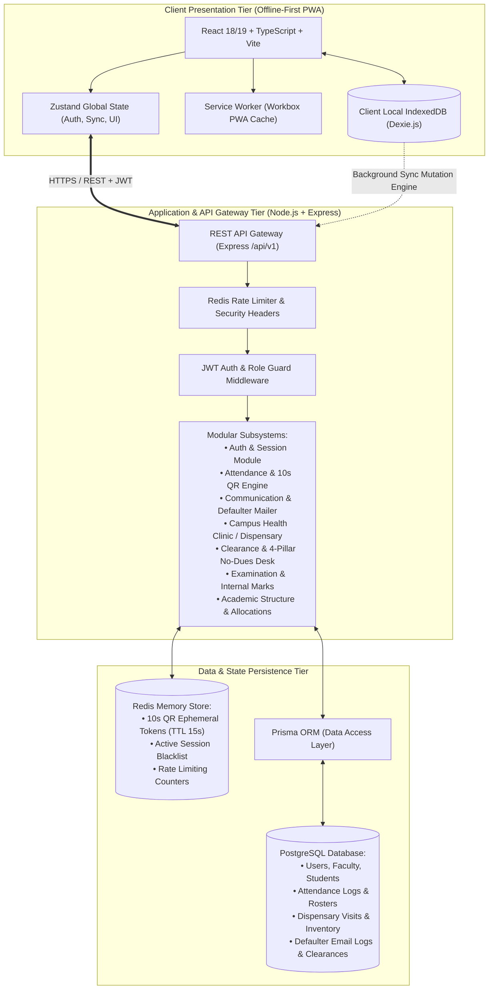
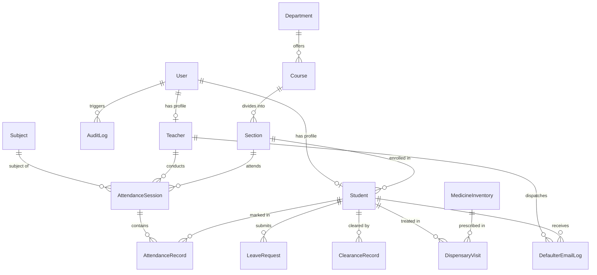

# 📋 AttendAI — Offline-First Smart Attendance & College ERP System

> **Enterprise-grade, offline-first Progressive Web App (PWA) attendance platform and integrated College ERP engineered specifically for engineering and professional degree institutions (AKTU aligned).**
> Fast classroom attendance marking (< 1 minute for 60 students), 10-second rotating QR code proxy elimination with **Fullscreen Projector Mode**, single-device hardware fingerprint binding with administrative device manager, IndexedDB offline queuing, background sync engine, automated defaulter email warnings, campus dispensary OPD desk, 4-pillar no-dues clearance, certified AKTU marksheet generator, and verified fee payment receipts.

---

## 📑 Table of Contents
1. [Project Overview & Key Innovations](#-project-overview--key-innovations)
2. [Problems Solved & High-Impact Features](#-problems-solved--high-impact-features)
3. [System Architecture (3-Tier Distributed)](#-system-architecture-3-tier-distributed)
4. [Technology Stack](#-technology-stack)
5. [User Roles & Permissions Matrix](#-user-roles--permissions-matrix)
6. [Core Operational Subsystems](#-core-operational-subsystems)
   - [Anti-Proxy 10s Rotating QR & Projector Mode](#1-anti-proxy-10s-rotating-qr--projector-mode)
   - [Hardware Device Fingerprint & Device Manager](#2-hardware-device-fingerprint--device-manager)
   - [Offline-First Sync Engine (IndexedDB & Service Worker)](#3-offline-first-sync-engine-indexeddb--service-worker)
   - [Automated Defaulter Warning Email Engine](#4-automated-defaulter-warning-email-engine)
   - [Campus Medical Dispensary & Health Clinic](#5-campus-medical-dispensary--health-clinic)
   - [Official AKTU Semester Marksheet & Transcript Generator](#6-official-aktu-semester-marksheet--transcript-generator)
   - [Digital Fee Payment Receipt & 4-Pillar No-Dues Desk](#7-digital-fee-payment-receipt--4-pillar-no-dues-desk)
   - [Session Auto-Lock & Administrative Unlock Desk](#8-session-auto-lock--administrative-unlock-desk)
   - [Academic Structure & Roster Upload](#9-academic-structure--roster-upload)
   - [Quick Academic Utility Dock (Calc & Scratchpad)](#10-quick-academic-utility-dock-calc--scratchpad)
   - [Live Timetable Tracking & Attendance Pulse Bar](#11-live-timetable-tracking--attendance-pulse-bar)
   - [Faculty 1-Click Roll Call Matrix & Lab 2x Credits](#12-faculty-1-click-roll-call-matrix--lab-2x-credits)
   - [Attendance Dispute Redressal & Claim Matrix](#13-attendance-dispute-redressal--claim-matrix)
   - [System Hardening & Enterprise Resilience Engineering](#14-system-hardening--enterprise-resilience-engineering)
   - [Assignment Submission & Review](#15-assignment-submission--review)
7. [Database Architecture & Data Modeling](#-database-architecture--data-modeling)
8. [Complete REST API Specification](#-complete-rest-api-specification)
9. [Folder Structure](#-folder-structure)
10. [Architecture Documentation Files (Root Folder)](#-architecture-documentation-files-root-folder)
11. [Getting Started & Local Setup](#-getting-started--local-setup)
    - [1-Click Windows Launch (start.bat)](#-1-click-windows-launch-startbat)
    - [Clean Shutdown (stop.bat)](#-clean-shutdown-stopbat)
    - [Manual CLI Setup](#-manual-cli-setup)
12. [1-Click Instant Demo Credentials](#-1-click-instant-demo-credentials)
13. [Testing & Quality Verification](#-testing--quality-verification)
14. [Security & Compliance](#-security--compliance)
15. [License](#-license)

---

## 🎯 Project Overview & Key Innovations

In traditional colleges and universities, classroom attendance consumes 10–15 minutes of every lecture using paper registers or brittle web apps that crash whenever campus Wi-Fi fluctuates. Furthermore, proxy attendance (scanning QR codes or signing for absent friends), manual tracking of the mandatory 75% AKTU attendance threshold, paper-heavy medical leave validations, and fragmented fee clearances severely degrade institutional efficiency.

**AttendAI** provides a unified, resilient, state-of-the-art solution:
- **Offline-First by Design:** Operates seamlessly even in Wi-Fi dead zones, lecture basements, or during internet disruptions. All reads and writes hit local IndexedDB first with automatic background reconciliation.
- **Fast 3-Tap Flow:** Teachers mark 60 students in under 60 seconds with bulk actions and 1-tap toggles.
- **Anti-Proxy Rotating Dynamic QR:** Encrypted HMAC-SHA256 tokens update every 10 seconds on the classroom projector screen, combined with hardware device fingerprint binding to eliminate proxy scanning.
- **Fullscreen Projector Mode:** High-contrast, large-format classroom display with real-time countdown progress circle and live student counter.
- **Automated Defaulter Warning Mailer:** Real-time percentage calculations with dynamic threshold sliders (50%–90%), shortage computations, and 1-click batch dispatch of official warning notices to students and parents.
- **Campus Health Clinic & Dispensary:** Integrated OPD consultation logging, pharmacy inventory with reorder threshold alerts, and instant 1-click validation of student medical leaves.
- **Academic Credentials & Finance:** Certified AKTU semester transcript generator and itemized fee payment receipt slips with cryptographic clearance verification.
- **Assignment Submission & Review:** Teachers publish assignments for assigned sections; students submit publicly accessible Google Drive PDFs, and teachers provide feedback, marks, and final sign-off.
- **Session Auto-Lock & Audit:** 24-hour tamper-proofing with administrative unlock approvals and immutable audit trails.

---

## 💡 Problems Solved & High-Impact Features

| Problem in Traditional Systems | AttendAI Enterprise Solution |
|---|---|
| **Slow Paper Registers** | High-speed 3-tap roster UI; 60 students marked in < 60 seconds. |
| **Proxy & Shared Photos of QR** | 10-second rotating encrypted QR codes + single-device hardware fingerprint binding. |
| **Unreliable College Wi-Fi** | True offline-first architecture; IndexedDB outbox queue + automatic background sync. |
| **End-Semester Defaulter Delays** | Instant < 75% defaulter detection with exact shortage calculation & 1-click batch warning emails. |
| **Fake Medical Certificates** | Campus Dispensary OPD integration cross-checks student health records for instant leave approval. |
| **Manual Exam Clearance Hurdles** | 4-Pillar digital clearance (Accounts, Library, Hostel, Department) unlocking examination hall tickets. |
| **Paper Marksheets & Receipts** | Instant digital AKTU Semester Marksheets (SGPA 8.42) and verified Paid Fee Payment Receipts. |
| **Tampered Attendance Records** | Append-only immutable audit trail + session auto-lock + Proctor/HOD unlock workflow. |
| **Device Swapping & Proxy Scan** | Device fingerprint lock with administrative reset desk for verified handset changes. |

---

## 🏗️ System Architecture (3-Tier Distributed)



---

## 💻 Technology Stack

### Frontend (PWA)
- **Framework:** React 18/19 + TypeScript (bundled with Vite)
- **Styling:** Vanilla CSS design tokens (custom institutional theme, glassmorphic card overlays, responsive micro-animations, touch targets $\ge$ 48px)
- **Offline Storage:** Dexie.js (IndexedDB wrapper) with client-side tables for offline rosters and pending mutations
- **PWA & Caching:** `vite-plugin-pwa` + Workbox with `stale-while-revalidate` and `network-first` strategies
- **State Management:** Zustand (`useAuthStore`, `useSyncStore`)
- **Security:** In-memory JWT access token, PBKDF2 local PIN screen-lock for idle sessions

### Backend (REST API)
- **Runtime & Language:** Node.js (v20+) with TypeScript and ts-node
- **Framework:** Express 5
- **Database ORM:** Prisma Client 6.4 (PostgreSQL 16)
- **In-Memory Cache & Ephemeral Tokens:** Redis 7 (via `ioredis`)
- **Validation:** Zod schemas (request coercion, unknown property stripping)
- **Testing:** Vitest with test coverage across core route handlers
- **Security Middleware:** `helmet` (strict CSP, HSTS), `cors` (with credentials), `express-rate-limit`
- **Logging:** Structured Winston logger (JSON in production, pretty-printed in development)

---

## 👥 User Roles & Permissions Matrix

| Feature / Module | Student | Teacher | HOD | Admin / Dean | Parent |
| :--- | :---: | :---: | :---: | :---: | :---: |
| **Mark Attendance (10s Live QR)** | ❌ | ✅ | ✅ | ❌ | ❌ |
| **Fullscreen Projector QR Mode** | ❌ | ✅ | ✅ | ❌ | ❌ |
| **Scan QR / Confirm Attendance** | ✅ | ❌ | ❌ | ❌ | ❌ |
| **Manual Roster Grading & Overrides**| ❌ | ✅ | ✅ | ✅ | ❌ |
| **Single-Date Attendance Snapshot** | ❌ | ✅ | ✅ | ✅ | ❌ |
| **Bunk / Attendance Shortage Forecast**| ✅ | ✅ (Class) | ✅ (Dept) | ✅ (College) | ✅ |
| **Download AKTU Semester Marksheet** | ✅ | ❌ | ✅ | ✅ | ✅ |
| **Download Official Paid Fee Receipt**| ✅ | ❌ | ❌ | ✅ | ✅ |
| **Defaulter Email Batch Dispatch** | ❌ | ✅ | ✅ | ✅ | ❌ |
| **Campus Clinic / Dispensary Desk** | ❌ (View) | ❌ | ❌ | ✅ | ❌ |
| **Medical / Duty Leave Sanctions** | Apply | Endorse | Sanction | Sanction | ❌ |
| **4-Pillar No-Dues Clearance Desk**| View Slip | ❌ | Department | Super Admin | ❌ |
| **Device Fingerprint Reset Desk** | ❌ | ❌ | ❌ | ✅ | ❌ |
| **Attendance Session Unlock Desk** | ❌ | ❌ | ✅ | ✅ | ❌ |
| **Placement Drives Registration** | ✅ | ❌ | ❌ | Manage | ❌ |
| **Anonymous Grievance Filing** | ✅ | ✅ | View Dept | Resolve All | ❌ |
| **Floating Academic Utility Dock** | ✅ | ✅ | ✅ | ✅ | ✅ |

---

## ⚙️ Core Operational Subsystems

### 1. Anti-Proxy 10s Rotating QR & Projector Mode
- **HMAC-SHA256 Ephemeral Token:**
  $$\text{Token} = \text{Truncate}\Big(\text{HMAC-SHA256}\big(K_{\text{secret}}, \text{SessionID} \parallel \lfloor t / 10 \rfloor\big), 8\Big)$$
- Token regenerates every 10 seconds on the screen. Any photograph or screenshot shared over WhatsApp or Telegram becomes invalid before a proxy can submit it.
- **Fullscreen Projector Mode (`ProjectorQRMode.tsx`):**
  - High-visibility projector canvas for auditoriums and smart lecture halls.
  - Giant live animated countdown progress ring.
  - Live verified student scan counter badge.
  - Sound cues on token refresh.

### 2. Hardware Device Fingerprint & Device Manager
- Attendance submissions bind student credentials to a unique, persistent hardware device fingerprint (`deviceId`).
- If an account attempts to submit attendance from a second device in the same session, AttendAI flags a `DEVICE_MISMATCH` proxy violation.
- **Admin Device Manager Desk (`DeviceManagerModal.tsx`):**
  - Allows college administrators to view registered hardware IDs.
  - Provides a 1-click administrative device reset for students who legitimately changed handsets or repaired phones.

### 3. Offline-First Sync Engine (IndexedDB & Service Worker)
- **IndexedDB Roster Cache:** Full student rosters and academic sections are available offline via Dexie.js.
- **Reconciliation Engine (`syncEngine.ts`):** Mutations performed during cellular dropouts are enqueued with client-generated UUIDs and idempotently replayed when connectivity returns.

### 4. Automated Defaulter Warning Email Engine
- Integrated in the Teacher and Admin dashboards.
- Dynamic cutoff slider (50% to 90%) allows instant filtering of students below attendance thresholds.
- Automatically calculates exact shortage:
  $$\text{Shortage} = \lceil 0.75 \times \text{Total Classes} \rceil - \text{Present}$$
- Dispatches institutional AKTU warning emails in batch with an audit trail recorded in `DefaulterEmailLog`.
- 1-Click export of the **Official AKTU Debarred Students CSV Report**.

### 5. Campus Medical Dispensary & Health Clinic
- **Clinical Consultation Ledger (`CampusDispensaryDesk.tsx`):** OPD logs recording roll number, patient name, attending doctor, diagnosis, and prescribed medications.
- **Pharmacy Inventory:** Stock tracking with automated reorder threshold warnings.
- **Emergency Directory:** Quick contact directory for affiliated referral hospitals and ambulance services.
- **1-Click Medical Leave Verification:** Matches student leave requests with OPD logs and attaches a **🏥 Clinic Verified** stamp for immediate administrative approval.

### 6. Official AKTU Semester Marksheet & Transcript Generator
- Displays official semester mark sheets aligned with Dr. A.P.J. Abdul Kalam Technical University guidelines.
- Itemizes course codes, subject titles, credit weightings, sessional internal marks (50), end-semester marks (100), total marks, and grades.
- Calculates Semester SGPA (8.42) with 1-click browser print / PDF export.

### 7. Digital Fee Payment Receipt & 4-Pillar No-Dues Desk
- **Digital Fee Slip (`FeeReceiptModal.tsx`):** Generates official institutional fee payment slips with breakdown (Tuition, AKTU Exam, High-Performance Lab, IEEE Digital Library, Hostel & Mess).
- **4-Pillar No-Dues Desk (`ClearanceManager.tsx`):** Multi-department signoff (Accounts, Library, Hostel, Department) unlocking end-semester admit cards and hall tickets.

### 8. Session Auto-Lock & Administrative Unlock Desk
- Attendance sessions auto-lock 24 hours after completion to guarantee record immutability.
- **Session Unlock Desk (`SessionUnlockDesk.tsx`):** HODs and Administrators can unlock historical sessions by providing a mandatory audit justification, which is logged to the system audit ledger.

### 9. Academic Structure & Roster Upload
- **Academic Structure Manager (`AcademicStructureManager.tsx`):** Complete management of Departments, Courses, Sections, and Subjects.
- **CSV Bulk Student Roster Upload:** Allows department staff to import entire class batches with roll numbers, names, and emails in a single click.

### 10. Quick Academic Utility Dock (Calc & Scratchpad)
- Floating bottom-right widget accessible across every screen in AttendAI.
- **Quick Bunk / Target Calculator:** Instant attendance target simulation without leaving current tasks.
- **Scratchpad Memo:** Auto-saving local storage notepad for faculty reminders and student lecture notes.

### 11. Live Timetable Tracking & Attendance Pulse Bar
- **Live Status Badges (`TodayTimetable.tsx`):** Every scheduled period automatically evaluates current IST time against lecture boundaries to display real-time status chips:
  - 🟢 **Ongoing:** Active lecture session currently in progress.
  - 🔵 **Upcoming:** Scheduled future lectures for today.
  - ⚪ **Completed:** Past lectures with confirmed attendance outcomes (`✓ Present`, `✗ Absent`, `🏛️ On-Duty`).
- **Real-Time Attendance Pulse Bar:** Interactive visual progress indicator showing the exact fraction of today's periods marked present vs. absent, providing instant daily clarity without digging through ledgers.

### 12. Faculty 1-Click Roll Call Matrix & Lab 2x Credits
- **Rapid Roll Call Launcher (`TeacherDashboard.tsx`):**
  - Instant mass actions: `✓ All Present` and `✗ All Absent` buttons mark 60+ students in 1 second.
  - Individual toggle switches permit rapid exceptions before saving.
- **Lab Practical 2x Credits Integration:**
  - Built-in `🧪 Lab Practical (2x Credits)` switch.
  - When enabled for practical sessions or workshops, credits and attendance hours scale to 2 units in institutional calculations.

### 13. Attendance Dispute Redressal & Claim Matrix
- **Dispute Redressal Modal:** Students can raise attendance correction requests directly from their daily timetable card for periods mistakenly marked absent.
- **Evidence Attachment & Faculty Inbox:** Attach explanations or medical tokens; faculty receives notifications in their Approvals desk for 1-click verification.

### 14. System Hardening & Enterprise Resilience Engineering
- **Demo Token Bridge:** Seamless integration for 1-click preview accounts (`token-*-demo-attendai`) connecting to real database entities without 401 token authentication rejections.
- **Dynamic Device UUID Generator:** Generates persistent browser client hardware fingerprints to eliminate PostgreSQL unique constraint collisions in multi-user test environments.
- **Administrative Role Enforcement:** Strict `requireRole('ADMIN', 'HOD')` guards on administrative decision endpoints preventing privilege escalation.
- **Synchronized Leave Approvals:** Approving a student leave automatically converts historical session records from `ABSENT` to `LV` / `OD` across the institutional ledger.
- **N+1 Query Elimination in Reporting:** Bulk query consolidation reduces 1500+ sequential SQL queries during class reports and defaulter calculations down to 2 optimized database round-trips.
- **Resilient Degraded Server Boot:** Backend gracefully handles initial connection dips to PostgreSQL or Redis without crashing the Express process.

### 15. Assignment Submission & Review
- Teachers create assignments for their assigned section and subject with instructions, maximum marks, and an optional deadline.
- Students submit Google Drive file links. The backend verifies public access and checks the PDF file signature before accepting a submission.
- Teachers review submissions, add feedback and marks, then sign off. Students can view grades and feedback; signed-off submissions are locked.

---

## 🗄️ Database Architecture & Data Modeling

Defined in [`backend/prisma/schema.prisma`](file:///c:/Users/DELL%20PC/Desktop/AttendAI/backend/prisma/schema.prisma) with full relational modeling:



---

## 🔌 Complete REST API Specification

All endpoints are mounted under `/api/v1`.

### 0. Health & Diagnostics (`/api/v1/health`)
| Method | Endpoint | Access | Description |
|---|---|---|---|
| `GET` | `/health` | Public | Root heartbeat status (`ok`), version, and UTC timestamp |
| `GET` | `/api/v1/health` | Public | Proxied microservice health check for PWA connectivity monitoring |

### 1. Authentication (`/api/v1/auth`)
| Method | Endpoint | Access | Description |
|---|---|---|---|
| `POST` | `/auth/login` | Public | Credentials authentication; issues JWT access token & HttpOnly refresh cookie |
| `POST` | `/auth/register` | Public | Role-based registration with automatic profile linking |
| `POST` | `/auth/refresh` | Public | Rotates refresh token from HttpOnly cookie |
| `POST` | `/auth/logout` | Public | Revokes refresh token and clears session |

### 2. Offline Synchronization (`/api/v1/sync`)
| Method | Endpoint | Access | Description |
|---|---|---|---|
| `GET` | `/sync/bootstrap` | Authenticated | Initial dataset load (timetable, sections, subjects, students) |
| `POST` | `/sync/push` | Authenticated | Receives outbox batch (up to 50 items) with item-level status responses |
| `GET` | `/sync/pull?cursor=` | Authenticated | Incremental change stream from server `change_log` |

### 3. Attendance Management (`/api/v1/attendance`)
| Method | Endpoint | Access | Description |
|---|---|---|---|
| `POST` | `/attendance/sessions` | Teacher, Admin, HOD | Creates or fetches session for section, subject, date, and period |
| `GET` | `/attendance/sessions/:id` | Authenticated | Retrieves session details and student roster |
| `POST` | `/attendance/sessions/:id/records` | Teacher, Admin, HOD | Batch records attendance status |
| `POST` | `/attendance/sessions/:id/unlock` | Admin, HOD | Unlocks locked session with audit justification |

### 4. Anti-Proxy Dynamic QR (`/api/v1/qr`)
| Method | Endpoint | Access | Description |
|---|---|---|---|
| `GET` | `/qr/token/:sessionId` | Teacher, Admin | Returns current 8-char HMAC token and countdown in 10s window |
| `POST` | `/qr/mark` | Student | Validates token, section membership, and device ID; marks Present |

### 5. Automated Communication & Defaulters (`/api/v1/communication`)
| Method | Endpoint | Access | Description |
|---|---|---|---|
| `POST` | `/communication/defaulters/send-warning-batch` | Teacher, Admin | Dispatches batch warning emails to students below attendance cutoff |
| `GET` | `/communication/defaulters/logs` | Teacher, Admin | Retrieves historical email dispatch audit records |

### 6. Campus Health Clinic & Dispensary (`/api/v1/dispensary`)
| Method | Endpoint | Access | Description |
|---|---|---|---|
| `GET` | `/dispensary/consultations` | Admin, Staff | Lists all logged clinic patient visits |
| `POST` | `/dispensary/consultation/log` | Admin, Staff | Logs new patient diagnosis and prescribes medication |
| `GET` | `/dispensary/verify-visit/:rollNo` | Admin, Staff | Checks if a student visited the clinic for medical leave verification |
| `GET` | `/dispensary/stock` | Admin, Staff | Lists medicine inventory and low-stock reorder warnings |
| `GET` | `/dispensary/emergency-directory` | Authenticated | Returns hospital contacts and emergency helpline numbers |

### Assignment Submission & Review (`/api/v1/assignments`)
| Method | Endpoint | Access | Description |
|---|---|---|---|
| `GET` | `/assignments/mine` | Student | Lists assignments for the student's section and their submission/grade |
| `GET` | `/assignments/teacher` | Teacher | Lists the teacher's assignments and student submissions |
| `POST` | `/assignments` | Teacher | Creates an assignment for an assigned section and subject |
| `PUT` | `/assignments/:id/submission` | Student | Submits or replaces a publicly accessible Google Drive PDF link |
| `PATCH` | `/assignments/submissions/:submissionId/review` | Teacher | Saves marks and feedback |
| `POST` | `/assignments/submissions/:submissionId/sign-off` | Teacher | Finalizes a grade and locks the submission |

### 7. Leaves, Clearances & Administrative Operations
| Method | Endpoint | Access | Description |
|---|---|---|---|
| `GET/POST` | `/leaves` | Authenticated | Submit or list leave applications (`MEDICAL`, `DUTY`, `CASUAL`) |
| `PATCH` | `/leaves/:id/decision` | Teacher, Admin | Sanction or reject leave with remarks |
| `GET` | `/reports/my-report` | Student | Personal overall & subject-wise percentage and bunk forecast |
| `GET` | `/reports/class?sectionId=` | Teacher, Admin | Aggregate class average, defaulter cards, and student tallies |
| `GET` | `/admin/stats` | Admin, HOD | High-level counts (students, faculty, courses, sessions, defaulters) |
| `POST` | `/admin/devices/reset` | Admin | Resets a student's bound hardware device ID |
| `POST` | `/academic/students/bulk` | Admin | Bulk CSV student roster import |

---

## 🗂️ Folder Structure

```
AttendAI/
├── AttendAI_System_Architecture_and_Design_Document.md    # Full Markdown architecture specification
├── AttendAI_System_Architecture_and_Design_Document.docx  # Formatted Microsoft Word document
├── AttendAI_System_Architecture_and_Design_Document.pdf   # Formatted printable PDF
├── AttendAI_System_Architecture_and_System_Diagrams.docx  # Architecture & system diagrams document
├── docker-compose.yml                                     # PostgreSQL 16 & Redis 7 services
├── start.bat                                              # 1-Click Windows startup launcher
├── stop.bat                                               # 1-Click clean shutdown launcher
├── README.md                                              # Complete project documentation
│
├── backend/                                               # Node.js + Express 5 + TypeScript API
│   ├── prisma/
│   │   ├── schema.prisma                                  # Relational Prisma schema
│   │   └── seed.ts                                        # Database seed script (50 students, 3 teachers)
│   ├── vitest.config.ts                                   # Vitest testing suite configuration
│   └── src/
│       ├── app.ts                                         # Express application setup & middleware pipeline
│       ├── index.ts                                       # Server startup & graceful shutdown
│       ├── middlewares/                                   # Auth, RBAC, Validation, Error Handler
│       └── modules/
│           ├── academic/                                  # Departments, courses, sections, subjects
│           ├── admin/                                     # System stats, rules, device manager
│           ├── attendance/                                # Sessions & roster handling
│           ├── auth/                                      # Passwords, OAuth, Demo accounts
│           ├── communication/                             # Defaulter batch warning email engine
│           ├── dispensary/                                # Clinic consultations & pharmacy inventory
│           ├── feedback/                                  # Institutional ratings & feedback
│           ├── leaves/                                    # Leave requests & clinic validations
│           ├── marks/                                     # Internal sessional marks
│           ├── qr/                                        # 10s rotating HMAC token generator
│           ├── reports/                                   # Bunk calculations & analytics
│           └── sync/                                      # Offline bootstrap, push, and pull
│
└── frontend/                                              # React 18/19 + TypeScript + Vite PWA
    ├── index.html                                         # HTML5 entry with PWA manifest
    ├── vite.config.ts                                     # Vite configuration & Workbox PWA
    └── src/
        ├── App.tsx                                        # Router, role guards, floating dock
        ├── index.css                                      # Design tokens & institutional theme
        ├── components/
        │   ├── admin/
        │   │   ├── AcademicStructureManager.tsx           # Dept, Course, Section, Subject manager & CSV upload
        │   │   ├── AdminGrievanceInbox.tsx                # Grievance redressal management
        │   │   ├── CampusDispensaryDesk.tsx               # Clinic ledger, pharmacy, emergency
        │   │   ├── ClearanceManager.tsx                   # 4-Pillar digital No-Dues desk
        │   │   ├── DeviceManagerModal.tsx                 # Hardware device ID reset manager
        │   │   ├── InstitutionalFeedbackManager.tsx       # Institutional feedback metrics
        │   │   ├── LeaveApprovalDesk.tsx                  # Leave sanctions + Clinic verification
        │   │   ├── NoticePublisher.tsx                    # Campus notices & circulars
        │   │   ├── PlacementManager.tsx                   # Placement drives & recruitment portal
        │   │   └── SessionUnlockDesk.tsx                  # Historical locked session unlock desk
        │   ├── common/
        │   │   ├── QuickAcademicUtilityDock.tsx           # Floating Calculator & Scratchpad
        │   │   └── UserProfileDrawer.tsx                  # Institutional identity drawer
        │   ├── student/
        │   │   ├── AttendanceLedgerWidget.tsx             # Date-wise class history table
        │   │   ├── BunkCalculator.tsx                     # Real-time AKTU 75% bunk forecast
        │   │   ├── FeeReceiptModal.tsx                    # Itemized paid fee payment receipt slip
        │   │   ├── GrievanceButton.tsx                    # Student anonymous grievance button
        │   │   ├── LibraryWidget.tsx                      # Book loans & digital library status
        │   │   ├── MarksGrid.tsx                          # Sessional & internal assessment grid
        │   │   ├── NoDuesWidget.tsx                       # 4-Pillar student clearance status
        │   │   ├── NoticeBanner.tsx                       # Live institutional notice broadcast
        │   │   ├── PlacementWidget.tsx                    # Student placement drive browser
        │   │   ├── StudentMarksheetModal.tsx              # Certified AKTU marksheet card (SGPA 8.42)
        │   │   └── TodayTimetable.tsx                     # Daily lecture schedule card
        │   └── teacher/
        │       ├── DefaulterEmailManager.tsx              # Cutoff slider & batch email dispatch
        │       ├── MarksEntryTab.tsx                      # Faculty internal marks grading
        │       ├── ProjectorQRMode.tsx                    # Fullscreen projector QR display
        │       ├── SingleDateAttendanceSnapshot.tsx       # Historical date/period roster inspector
        │       ├── TeacherLeaveTab.tsx                    # Faculty leave request suite
        │       └── UpcomingClassCard.tsx                  # Next lecture widget
        └── pages/
            ├── LoginPage.tsx                              # 1-Click demo accounts & role tabs
            ├── teacher/TeacherDashboard.tsx               # Mark attendance, Projector QR, Marks, Reports
            ├── student/StudentDashboard.tsx               # Overview, QR scan, Marksheet, Receipts, Leaves
            └── admin/AdminDashboard.tsx                   # Stats, Clinic, Academic setup, Clearances, Unlocks
```

---

## 📑 Architecture Documentation Files (Root Folder)

The complete architectural specifications, system diagrams, and operational workflows have been compiled and exported in the project root folder:

1. **📄 PDF Document (Ready to print & share):**
   [`AttendAI_System_Architecture_and_Design_Document.pdf`](file:///c:/Users/DELL%20PC/Desktop/AttendAI/AttendAI_System_Architecture_and_Design_Document.pdf)
2. **📝 Word Document (.docx - Comprehensive Architecture):**
   [`AttendAI_System_Architecture_and_Design_Document.docx`](file:///c:/Users/DELL%20PC/Desktop/AttendAI/AttendAI_System_Architecture_and_Design_Document.docx)
3. **📊 Word Document (.docx - System Diagrams & Models):**
   [`AttendAI_System_Architecture_and_System_Diagrams.docx`](file:///c:/Users/DELL%20PC/Desktop/AttendAI/AttendAI_System_Architecture_and_System_Diagrams.docx)
4. **📑 Markdown Document (.md - Full Spec):**
   [`AttendAI_System_Architecture_and_Design_Document.md`](file:///c:/Users/DELL%20PC/Desktop/AttendAI/AttendAI_System_Architecture_and_Design_Document.md)

---

## 🚀 Getting Started & Local Setup

### ⚡ 1-Click Windows Launch (`start.bat`)
Simply double-click the **`start.bat`** script located in the root directory:
```cmd
start.bat
```
This automatically:
1. Verifies Node.js installation (v20+).
2. Generates `backend\.env` from `.env.example` if not already present.
3. Automatically installs dependencies (`npm install`) if `node_modules` is missing.
4. Boots PostgreSQL 16 and Redis 7 containers via Docker Compose (with graceful fallback if Docker engine is offline).
5. Generates the Prisma ORM Client.
6. **Smart Port Collision Detection:** Checks if ports 4000 or 5173 are already running to prevent duplicate process conflicts.
7. Launches the Backend API on `http://localhost:4000` in its own window.
8. Launches the Frontend PWA on `http://localhost:5173` in its own window.
9. Automatically opens `http://localhost:5173` in your default browser.

### 🛑 Clean Shutdown (`stop.bat`)
To terminate all AttendAI services and containers cleanly:
```cmd
stop.bat
```
This safely stops processes listening on ports 4000 and 5173 and brings down Docker containers.

---

### 🛠️ Manual CLI Setup

#### 1. Prerequisites
- **Node.js** (v20+ LTS): `node -v`
- **npm** (v10+): `npm -v`
- **Docker Desktop** (optional for PostgreSQL & Redis): `docker compose version`

#### 2. Start PostgreSQL & Redis Containers
```bash
docker compose up -d
```

#### 3. Backend Setup
```bash
cd backend
cp .env.example .env
npm install
npx prisma generate
npx prisma migrate dev --name init
npm run db:seed
npm run dev
```
Backend API will listen on **`http://localhost:4000`**.

#### 4. Frontend Setup
```bash
cd ../frontend
npm install
npm run dev
```
Frontend PWA will be available at **`http://localhost:5173`**.

---

## 👥 1-Click Instant Demo Credentials

AttendAI includes **1-Click Instant Demo Chips** at the top of the login screen (`/login`). You can access all portals instantly without typing passwords:

| Role | Demo Account | Default Email | Default Password | Access Path |
|---|---|---|---|---|
| **🎓 Student** | Aman Kumar | `student1@attendai.com` | `Student@123` | `/student` |
| **👨‍🏫 Faculty** | Dr. Rajesh Sharma | `teacher1@attendai.com` | `Teacher@123` | `/teacher` |
| **🏛️ Admin / Dean** | Dean Academics | `admin@attendai.com` | `Admin@123` | `/admin` |

---

## 🧪 Testing & Quality Verification

### Run Type Checks and Production Builds
Both packages compile cleanly with zero TypeScript errors:

```bash
# 1. Run Backend Automated Test Suite (Vitest)
cd backend
npm run test

# 2. Run Backend Production TypeScript Build
npm run build

# 3. Run Frontend Type Checks & PWA Build
cd ../frontend
npm run build
```

### End-to-End Visual Verification
- **Student Dashboard:** View attendance meter, run Bunk Calculator, view AKTU Semester Marksheet, and download Paid Fee Receipt.
- **Teacher Dashboard:** Conduct 10s rotating QR session, toggle Fullscreen Projector QR Mode, inspect single-date historical rosters, review defaulters, and fire batch warning emails.
- **Admin Dashboard:** Access Campus Health Clinic (OPD log & pharmacy inventory), sanction medical leaves with 1-click clinic verification, manage 4-Pillar digital clearances, reset student device IDs, and unlock locked historical sessions.
- **Universal Floating Dock:** Access quick attendance calculations and auto-saving scratchpad memo from anywhere in the application.

---

## 🔒 Security & Compliance

- **Short-Lived JWTs:** In-memory access tokens (15-min lifespan) prevent XSS token harvesting.
- **Single-Use Refresh Tokens:** Rotated inside `HttpOnly`, `SameSite=Strict` cookies.
- **Zero-Trust QR Window:** 10-second TTL prevents screenshot re-use.
- **Device Fingerprint Binding:** Prevents multiple students from scanning attendance with a single smartphone.
- **Append-Only Auditing:** Record modifications, overrides, and session unlocks generate immutable entries in `audit_logs`.
- **Zod Input Sanitization:** Strict input schemas prevent SQL injection, prototype pollution, and unexpected payload tampering.

---

## 📄 License
This project is licensed under the MIT License.  
Designed and engineered for educational excellence by **@aman**.
